## 1 - Lab 11 - Introdução ao Amazon EC2

## 1. Objetivo

Documentar a criação e a configuração de uma instância Amazon EC2 para hospedar um servidor web na AWS, registrando as configurações utilizadas, os testes realizados e os aprendizados obtidos durante o laboratório.

## 2. Configuração inicial

### 2.1. Configuração de rede

Preparação das configurações de rede necessárias para a instância EC2.

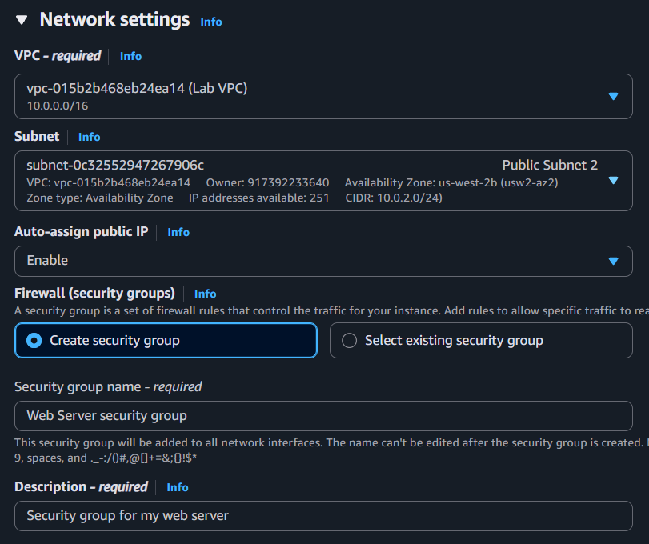

### 2.2. Instâncias EC2

Visualização das instâncias criadas durante o laboratório.

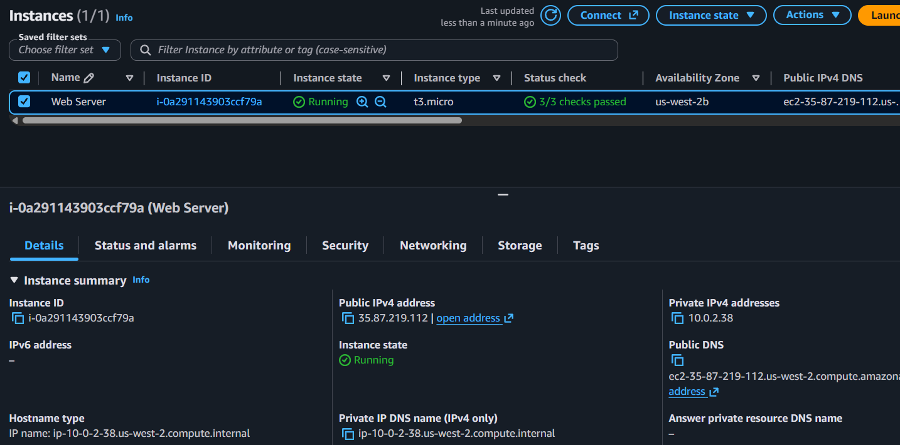

## 3. Configuração do servidor web

### 3.1. Grupo de segurança HTTP

Configuração de uma regra de entrada para permitir o acesso HTTP ao servidor web pela porta 80.

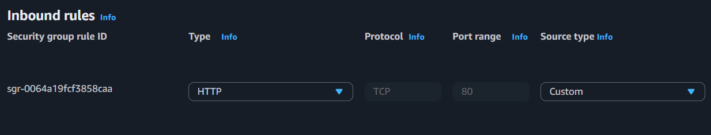

### 3.2. Teste do servidor web

Verificação do acesso à página hospedada na instância EC2 após a configuração do servidor web Apache.

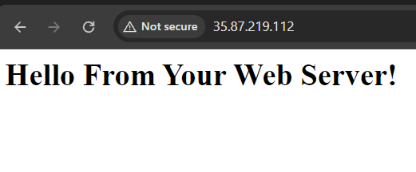

## 4. Ajustes na infraestrutura

### 4.1. Redimensionamento do volume EBS

Registro do aumento de tamanho do volume de armazenamento EBS associado à instância.

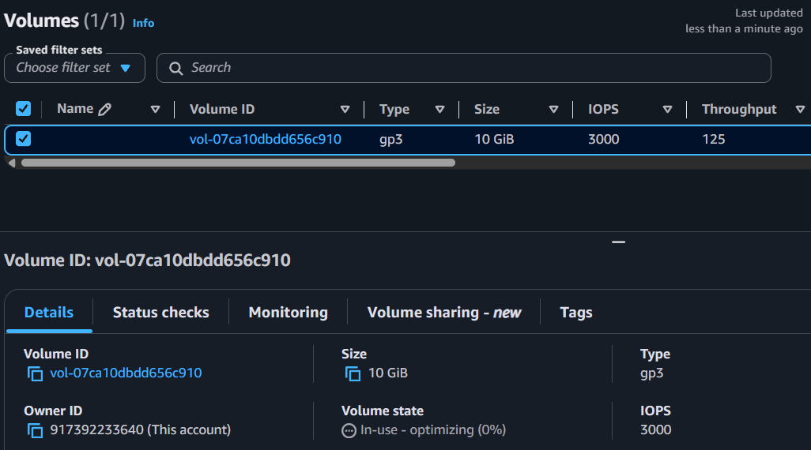

### 4.2. Redimensionamento da instância

Registro da alteração das configurações da instância EC2 durante os experimentos do laboratório.

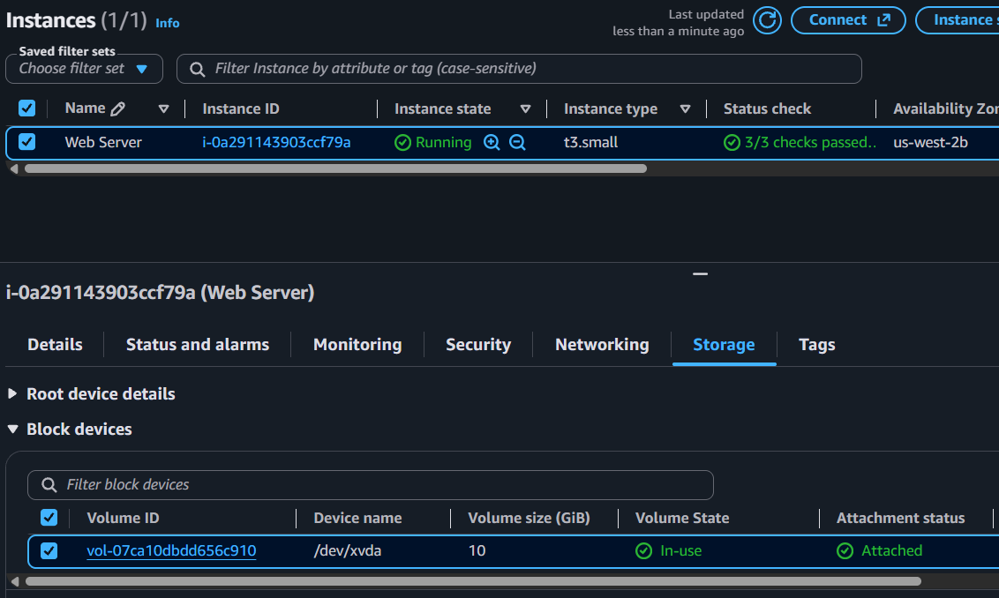

### 4.3. Proteção contra encerramento

Teste da proteção contra encerramento da instância. A tentativa de encerramento foi bloqueada, demonstrando o funcionamento dessa configuração de segurança.

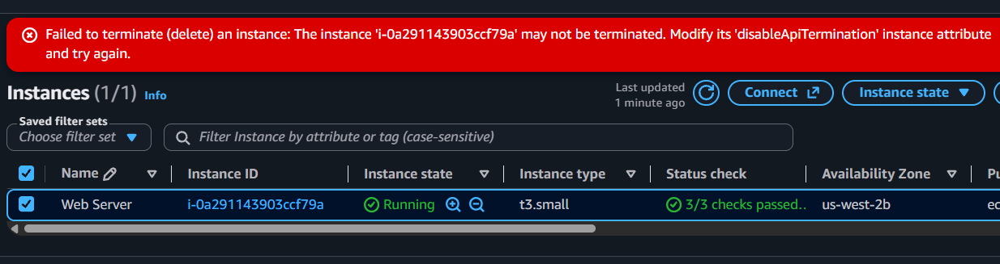

## 5. Experimentos adicionais

Além das atividades principais, foram realizados experimentos para investigar o comportamento da instância e praticar o acesso remoto ao Linux.

### 5.1. Alteração do User Data após a criação da instância

Após criar a instância EC2, editei o User Data para personalizar a página inicial do servidor, exibindo meu nome, **“Bruno Carvalho”**, e a mensagem **“Meu servidor Web na AWS”**. Porém, mesmo após reiniciar a instância, a página continuou exibindo o conteúdo anterior.

Para investigar e resolver o problema, acessei a instância remotamente pelo PuTTY, utilizando SSH, e alterei diretamente o arquivo HTML servido pelo Apache.

**Método 1: edição manual com Nano**

```bash
sudo nano /var/www/html/index.html
```

O comando abre o arquivo HTML para edição manual.

**Método 2: gravação direta com Echo e Tee**

```bash
echo '<html><h1>Bruno Carvalho</h1><p>Meu servidor Web na AWS</p></html>' | sudo tee /var/www/html/index.html
```

Esse comando grava o HTML diretamente no arquivo. O `echo` fornece o conteúdo, o pipe (`|`) encaminha o texto para o `tee`, e o `sudo` permite escrever no diretório protegido do servidor.

Os dois métodos permitem alterar o mesmo arquivo de maneiras diferentes. Aprendi também que editar o User Data após a criação da instância não significa que o script será executado automaticamente em uma reinicialização comum.

**Aprendizados:** User Data, acesso remoto via SSH com PuTTY, edição de arquivos com Nano e gravação de conteúdo com Echo e Tee.

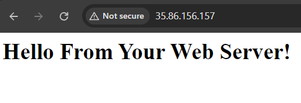

### 5.2. Acesso remoto com PuTTY

Estabelecimento de uma conexão SSH com a instância EC2 utilizando o PuTTY para executar comandos e administrar os arquivos do servidor.

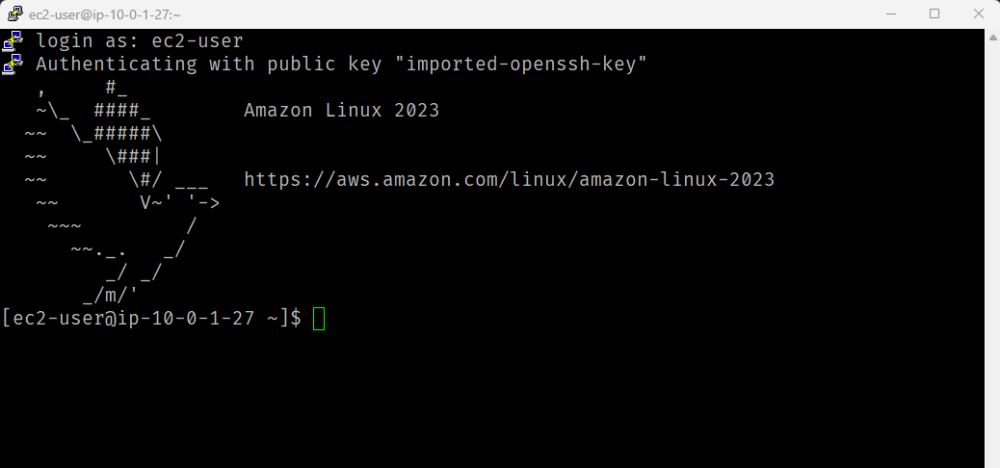

### 5.3. Atualização da página web

Verificação da página após a atualização dos arquivos publicados pelo servidor web.

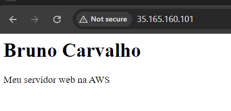

### 5.4. Página personalizada

Criação de uma página HTML com CSS para apresentar os estudos práticos em computação em nuvem.

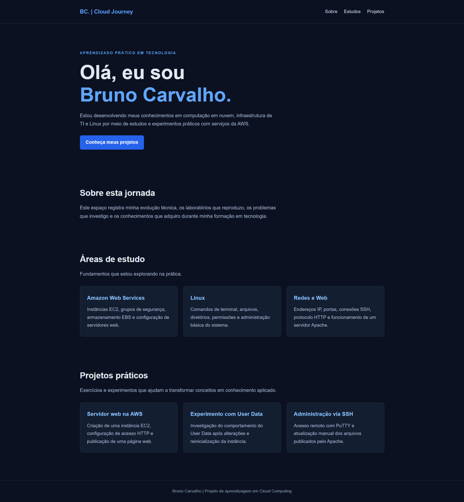

Visite aqui: https://brunogacarvalho.github.io/lab-11-introducao-ec2/

## 6. Tecnologias utilizadas

- Amazon EC2
- Amazon Linux 2023
- Amazon EBS
- Security Groups
- Apache HTTP Server
- Linux e comandos de terminal
- SSH e PuTTY
- HTML e CSS
- Git e GitHub

## 7. Organização do projeto

- `README.md`: documentação do laboratório e das evidências.
- `screenshots/`: capturas de tela das configurações e dos testes.
- `website/`: código-fonte HTML e CSS da página personalizada.

## 8. Aprendizados

O laboratório permitiu praticar a criação e a configuração de instâncias EC2, o controle de acesso por grupos de segurança, o gerenciamento de armazenamento EBS e a publicação de uma página web.

Os experimentos adicionais também envolveram a investigação do User Data, o acesso remoto por SSH e a edição manual dos arquivos do servidor web.

## 9. Observação

Este repositório reúne a documentação e as evidências visuais do laboratório, além de experimentos adicionais realizados para aprofundar o aprendizado. As capturas de tela registram as etapas e os resultados observados durante essas atividades.
